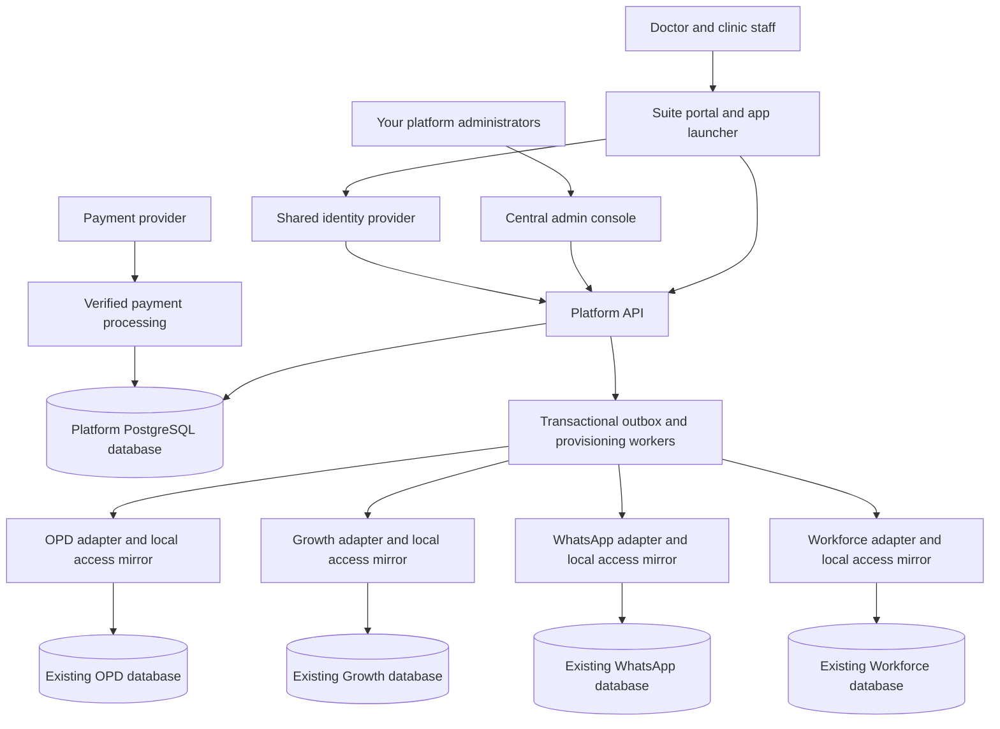

# Doctor Suite: shared administration, subscriptions and seven-day trials

Prepared 18 October 2026. Design proposal based on local source review; no application code, deployed configuration or database was changed.

Implementation update: the initial Suite Admin control plane has now been added locally, using the OPD Supabase project as its intended backend and a separate frontend build. See [implementation status and deployment guide](SUITE_ADMIN_IMPLEMENTATION.md) for what is implemented and what still needs product integration. The audit statement above describes the original review, not the subsequent implementation.

## 1. Recommendation and scope

Messaging design update: OPD/Growth use legacy messaging integration while Workforce shares the multi-user WhatsApp backend and also has separate notification routing. Treat messaging services as explicit dependencies, not one universal WhatsApp product endpoint. The source audit, revised topology and rollout requirements are in [Suite messaging integration plan](SUITE_MESSAGING_INTEGRATION_PLAN.md); that document supersedes the simplified shared-messaging assumption below.

Create a separate **Doctor Suite Platform** that owns login identity, organisations, memberships, product catalogue, subscriptions, trial eligibility and effective access. Give doctors one portal, one organisation setup, one staff directory and one billing area. Keep the existing product deployments and operational databases initially.

| Product code | Product | Repository reviewed | Scope |
|---|---|---|---|
| `opd` | Clinic operations: OPD, prescriptions, billing and pharmacy; existing IPD capability | `C:\app folders\OPD management\project` | Bundle product |
| `growth` | GMB/reviews and clinic growth workflows | `D:\app\gmb review system\project` | Bundle product |
| `whatsapp` | WhatsApp communication and automation | `D:\app folder\Whatsapp new app multi user\whatsapp multi user bulk` | Bundle product and shared messaging service |
| `workforce` | Tasks, HR, attendance and payroll | `D:\task manager android app\project` | Bundle product |
| Reference only | LIMS | `D:\LIMS version 2\project` | Reuse lifecycle ideas; excluded from this bundle |

“Consistent schema” means a common identity, organisation, membership, subscription and entitlement contract. Clinical encounters, Google profiles, WhatsApp sessions and payroll records retain their appropriate product schemas. No immediate consolidation of clinical and payroll databases is required.

This is a repository audit, not a production certification. Migration files and schema snapshots can differ from deployed databases. Live RLS, cron jobs, actual prices, payment configuration and deployment versions still require a read-only inventory before implementation.

## 2. What exists today

| Product | Identity and tenant model | Commercial/access model found | Migration implication |
|---|---|---|---|
| OPD | Supabase Auth; `profiles.user_id`, `profiles.clinic_id`; clinic settings and roles/permissions | `clinic_tier` Basic/Silver/Gold; separate `ipd_enabled`; route/navigation feature checks | Map clinic to platform organisation/location. Replace independent tier decisions with centrally derived capabilities. No complete subscription/trial lifecycle found in reviewed paths. |
| Growth | Current login uses Supabase Auth; `public.users.auth_id` maps to an application user. Clinic details and most data ownership sit on that user. | `saas_plans`, `saas_plan_features`, `user_subscriptions`, `usage_events`; CCAvenue orders/transactions; per-user `enabled_features` | Strongest existing catalogue/payment foundation. Convert commercial ownership from user to organisation and preserve legacy feature grants explicitly. |
| WhatsApp | Express backend, PostgreSQL/Drizzle, bcrypt login and custom JWTs; text `organization_id`; sessions also have `user_id` | Per-user feature switches; no subscription/trial lifecycle found in searched backend/client/schema paths | Add central identity mapping, organisation-owned channels, entitlement checks and revocation-aware sessions. |
| Workforce | Supabase Auth; `users.auth_id`, `users.organization_id`; `organizations`; user-management Edge Functions | Schema snapshots contain `subscription_status`, `trial_ends_at` defaulting to 14 days, `max_users` and `current_users`; no matching expiry enforcement found in searched TS/SQL | Useful organisation/user model, but trial columns alone do not provide a working seven-day subscription system. |
| LIMS reference | Supabase Auth plus `users`, `labs`, locations | Seven-day lab creation, `plan_status`, `active_upto`, subscription tables, admin extension/suspension, inactive screen and conditional daily expiry cron | Reuse the concepts, with exact server-time checks and a general product model. |

### Evidence and important differences

- **OPD:** `src/services/authService.ts` creates staff with browser-side `supabase.auth.signUp()` and a separate profile insert. The shared platform should use a server-authorised invitation/provisioning workflow, preserving the administrator's session and making partial failures recoverable.
- **OPD:** `supabase/migrations/20260407_add_clinic_tier.sql`, `20260713000000_add_ipd_enabled.sql`, `src/App.tsx`, navigation and profile services contain existing gates. Some defaults differ between Basic and Silver; central capability resolution should eliminate that ambiguity.
- **OPD pricing:** `PRICING_PLAN_LIMS_OPD_HR.md` advertises an older INR 2,500/month all-in-one offer including LIMS. This is a document, not evidence of the present live catalogue, and its scope conflicts with the requested LIMS exclusion. Do not reuse it as the new offer without revising it.
- **Growth login:** `src/store/useStore.ts` currently calls `signInWithPassword` and looks up `users.auth_id`. Older comments describe custom authentication; current source takes precedence over those comments.
- **Growth billing:** `20260625093000_add_saas_plan_foundation.sql` preserves existing `enabled_features` in subscription rows. `20260715090000_harden_ccavenue_payments.sql` adds payment replay protection and a three-day grace period for overdue CCAvenue subscriptions. This is not a general seven-day trial engine; manually granted accounts are excluded from that expiry function.
- **Growth isolation:** `20260701090000_disable_report_requests_rls_for_custom_auth.sql` disables report-request RLS. No later re-enable was found in the reviewed later migrations. Verify the actual database, then restore and test tenant policies before enabling suite access.
- **Growth roles:** the SaaS migration's `is_platform_admin()` accepts local `admin` and `super_admin`. Establish which legacy admins are clinic owners; a clinic owner must not inherit platform billing or cross-organisation administration.
- **WhatsApp:** authoritative schema for the Node backend is `NodeBackend/shared/schema.ts`, as resolved by `NodeBackend/tsconfig.json`; root `shared/schema.ts` is older/different. `server/services/AuthService.ts` issues seven-day JWTs. That token duration is a login-session lifetime, not a product trial.
- **WhatsApp:** `server/routes.ts` contains both authenticated tenant handling and legacy header/query/body/default fallbacks. Inventory API-key and integration callers before removing fallbacks; browser input alone must never establish tenant authority.
- **Workforce:** `src/App.tsx` can repair a missing organisation by selecting the first available organisation. Replace this with an explicit verified membership/invitation, even if existing RLS currently limits what the query sees. The separate `project 2 admin app` directory has admin-related files; their presence does not establish a complete deployed admin application.
- **LIMS:** `create-lab-with-admin/index.ts` sets a seven-day `active_upto`; `AuthContext.tsx` compares expiry against local midnight; `ProtectedRoute.tsx` permits renewal for inactive labs. The migration schedules daily expiry only when `pg_cron` exists. Consequently, the copied design must not rely on that cron or browser date comparison for exact expiry.
- **LIMS:** plan prices are seeded in SQL and repeated in `src/pages/Subscription.tsx`. The suite should read its catalogue from one API. The separate `delete_trial_lab_data` SQL function mentions a five-day demo; trial expiration in the new platform must not call this purge workflow.

## 3. Product and plan catalogue

Launch with one clear standalone offer per app and one flagship complete bundle. Existing feature modules remain configurable internally. Additional packages can be introduced without another schema design.

**Proposed packages and starting allowances below are product decisions, not existing limits or approved prices.** All new eligible trials last seven days. Monthly and annual prices are separate versioned rows. Final rupee amounts should be set after reviewing current customer commitments and measured messaging/AI/storage/support costs.

| Plan code | Customer-facing offer | Included capability | Proposed starting allowance | Trial | Price setup |
|---|---|---|---|---|---|
| `clinic_core` | Clinic Operations | OPD, appointments, prescriptions, billing, pharmacy | 1 location, 2 doctors, 5 staff | 7 days | Monthly/annual, amount TBD |
| `clinic_growth` | Clinic Growth | Reviews/GMB, sequences and existing growth modules selected for this offer | 1 location, 1 Google Business Profile, 3 staff | 7 days | Monthly/annual, amount TBD |
| `clinic_connect` | Patient Communication | WhatsApp channel, messaging, campaigns and selected chatbot workflows | 1 connected number, 3 operators; metered messaging/AI | 7 days | Monthly/annual plus usage, amount TBD |
| `clinic_workforce` | Staff & Tasks | Tasks, HR, attendance, leave and payroll | 1 location, 10 employees | 7 days | Monthly/annual, amount TBD |
| `doctor_complete` | Complete Doctor Suite | All four offers under one organisation, portal and bill | 1 location, 2 doctors, 10 unique staff, 1 Google profile, 1 WhatsApp number | 7 days across eligible products | Bundle monthly/annual, amount TBD |
| `hospital_ipd` | Hospital/IPD add-on | Existing IPD capability in the OPD application | Limits to be defined for hospital customers | Eligible feature trial within OPD trial window | Add-on price, amount TBD |
| Resource add-ons | Additional capacity | Locations, doctors/employees, numbers, Google profiles, storage and AI credits | Explicit purchased quantities | Does not restart base trial | Per-unit/versioned prices |

One employee using three apps counts once for the bundle's unique staff allowance. Doctor licences and workforce employee allowances are separate counters. Define whether a doctor is also a payroll employee explicitly; do not charge by the number of login records copied into databases.

The Growth migration seeds Review Booster and Appointment Reminder at INR 999/month each, Sequence Sender at INR 1,499/month, Smart Reports at INR 1,999/month and Clinic Growth Suite at INR 3,999/month, with annual values also stored. These are observed seed values only, not verified live prices or the new bundle recommendation. Preserve any contracted standalone plans during migration.

Avoid promising unlimited AI, voice or provider messaging within a fixed subscription. Trials get configurable quotas and no automatic paid overage. Show what is included, what is exhausted, and what requires paid credits before the action.

## 4. Target architecture



The platform owns commercial truth. Each app consumes a versioned local access mirror for fast checks and owns its own operational records. A central deployment adds the admin UI, portal/API and workers; the current app deployments continue independently. A shared domain and app switcher can make this feel like one product without a single frontend build.

Use separate staging/production platform instances, app bindings and provider credentials. An app instance identifies a specific deployment/database environment, not just a product name.

## 5. Shared schema proposal

Use UUIDs for new platform entities, `timestamptz` for timestamps and integer minor currency units for money. Store legacy IDs as text in mapping tables because WhatsApp organisation IDs are strings. The following is a logical schema, not an executable migration.

| Central table | Key fields / relationships | Purpose and constraints |
|---|---|---|
| `platform_users` | `id`, `display_name`, `verified_email`, `status` | One person across products; no passwords in this table |
| `identity_links` | `user_id`, `issuer`, `subject` | Unique `(issuer, subject)`; linking requires verified control, not a matching email string |
| `organizations` | `id`, `name`, `slug`, `status`, `billing_email`, `timezone` | Customer account; status independent of subscription; default display timezone Asia/Kolkata |
| `locations` | `id`, `organization_id`, `name`, `status` | Branches/facilities within the account |
| `memberships` | `id`, `organization_id`, `user_id`, `role`, `status`, `version` | Unique `(organization_id, user_id)`; owner/admin/member/billing roles |
| `membership_product_roles` | `membership_id`, `product_id`, `role_code`, `location_id` | Product-specific roles and branch scope; enforce location belongs to the membership's organisation |
| `invitations` | `organization_id`, `email`, `token_hash`, `expires_at`, `accepted_at`, `inviter_id` | Single-use staff invitations; role grants stored server-side |
| `products` / `features` | stable product codes; namespaced feature codes | Examples: `opd.prescriptions`, `growth.reviews`, `whatsapp.campaigns`, `workforce.payroll` |
| `plans` / `plan_versions` | `id`, `code`, `version`, `kind`, `published_at` | Standalone, bundle and add-on offers; published versions immutable |
| `plan_products` / `plan_features` | `plan_version_id`, `product_id`, `feature_id`, `limit_value`, `limit_unit`, `merge_rule` | A bundle is a plan with several products; limits typed and explicit |
| `plan_prices` | `plan_version_id`, `currency`, `interval_unit`, `interval_count`, `amount_minor`, provider price reference | Separate monthly/yearly prices; new price rows for price changes |
| `subscriptions` | `id`, `organization_id`, `status`, `period_start`, `period_end`, `cancel_at_period_end`, provider references | Multiple subscriptions permitted for separate products; payment status is not the access decision |
| `subscription_items` | `subscription_id`, `plan_version_id`, `price_id`, `quantity`, effective dates | Stores purchased bundle/add-ons; immutable commercial snapshots |
| `product_trials` | `organization_id`, `product_id`, `started_at`, `ends_at`, `status`, optional `trial_group_id` | Unique `(organization_id, product_id)`; preserves consumed trials across plan switches |
| `access_grants` | `organization_id`, `product_id`, `feature_id`, `source_type`, `source_id`, validity, quota | Traceable paid, trial and grandfathered access; manual grants require reason/actor/expiry |
| `entitlement_snapshots` | `organization_id`, `product_id`, effective capabilities/limits, `version`, `valid_until`, `refresh_by` | Derived access cache; not an independently editable subscription |
| `app_instances` / `organization_app_bindings` | product, environment, `organization_id`, optional `location_id`, `local_tenant_id`, provisioning status | Support multiple clinic/branch tenants in a product; unique local tenant mapping within an app instance |
| `app_user_bindings` | `user_id`, `app_instance_id`, `local_auth_id`, `local_profile_id` | Preserve existing IDs and foreign keys; one local identity belongs to one platform person |
| `orders` / `order_items` / `payment_transactions` | organisation, expected amount/currency, plan version snapshot, provider references, outcome | Separate SaaS billing from OPD patient invoices; payment/provider IDs unique in provider/account scope |
| `webhook_receipts` | provider account, event ID or stable callback key, payload hash, processing state | Durable deduplication and reconciliation history |
| `usage_events` / `usage_counters` | organisation, product, meter, period, quantity, source event ID | Atomic quota reservations; dedupe retries; do not put patient content in usage events |
| `outbox_events` / `delivery_attempts` / `provisioning_steps` | event ID, entity version, target app, idempotency key, status/error | Recoverable propagation and provisioning; unique target/event processing |
| `platform_admin_roles` / `audit_events` | actor, scope, action, target, reason, before/after, timestamp | Your support/billing/operations roles remain separate from clinic admins |

Every tenant-scoped relationship must prevent cross-organisation references. Where possible use composite foreign keys including `organization_id`, rather than relying only on application checks. Use uniqueness/locking to prevent duplicate grants, trial starts, provisioning jobs and purchases for the same request.

Minimum compatible tables in each product database:

| Local table | Contents |
|---|---|
| `platform_tenant_bindings` | Platform organisation/location to existing local tenant ID |
| `platform_memberships` | Platform person, local auth/profile IDs, roles, status, source version and refresh deadline |
| `platform_entitlements` | Effective product/features, quotas, paid/trial deadline, version and refresh deadline |
| `platform_event_receipts` | Applied event IDs and versions, with delivery status |

These mirrors are writable only by a scoped server integration. Existing `clinic_id` and local `organization_id` values remain intact initially. Add and backfill `platform_organization_id` where useful; do not rename/re-key all operational tables in the first release.

## 6. One login and consistent user administration

Use an OIDC identity provider for the suite. Prefer a migration that **preserves local Supabase Auth users** in OPD, Growth and Workforce, federating their login through the common provider and linking each local identity to a platform user. This reduces changes to existing `auth.users` foreign keys and `auth.uid()` policies.

Supabase documents custom OAuth/OIDC providers for this kind of delegated login. A central Supabase project could also serve as the identity provider, but its OAuth server is currently documented as beta; validate suitability and cross-project account linking in staging before choosing it for production. [Custom OAuth/OIDC providers](https://supabase.com/docs/guides/auth/custom-oauth-providers), [OAuth server setup](https://supabase.com/docs/guides/auth/oauth-server/getting-started).

A second possible approach is direct trust of the central issuer in each product's database API. Supabase documents custom third-party OIDC, but this does not automatically preserve local `auth.users` relationships; `auth.uid()` also expects a UUID subject. That approach needs a larger RLS/identity rewrite and is not the default migration here. [Custom third-party OIDC](https://supabase.com/docs/guides/auth/third-party/custom-oidc).

Required staging proof: an existing OPD user signs in through the central provider and retains the same local auth/profile identity, refresh works, row policies still isolate clinics, and logout/removal revokes effective access. Repeat for Growth, Workforce and Android before expanding rollout. If existing-account linking cannot be made reliable, use an explicit account-linking migration before switching login; do not silently create duplicate profiles.

For WhatsApp, use a server OIDC callback and map the verified identity to its existing user. Establish a short-lived local session and enforce current membership/access separately; a seven-day JWT alone cannot reflect a suspension promptly. Validate issuer, audience, signature, expiry, state and PKCE as appropriate; never copy Supabase signing secrets between projects or send bearer tokens in app-launch URLs.

Central admin creates/invites users once, selects the organisation, location and allowed apps, and assigns product roles. A receptionist might use OPD and Growth but have no payroll access. An organisation owner's purchasing power does not automatically grant access to all employee/clinical records. Platform support access must be separately scoped and audited.

Existing accounts are linked using verified login or administrator-reviewed migration evidence. Shared emails, names, phone numbers or clinic names are matching hints, not sufficient authority to merge accounts. Disable independent credential/organisation mutation for migrated tenants or route it through the platform. Keep app-specific doctor qualifications and employment data in their owning app.

## 7. Organisation creation and provisioning

1. Verify the owner identity and collect organisation name, contact details and first location.
2. In one platform transaction, create the organisation, owner membership, selected plan intent and an outbox event. Require a client idempotency key so a retried form cannot create a second organisation.
3. Provision selected product tenants asynchronously using server credentials and unique `(organization, app instance, location)` steps. Record local IDs only after verified success; never choose a default/first available tenant.
4. Create/link local owner identities, assign approved roles and seed product settings idempotently. Track failures by app and retry the failed step, not the whole signup.
5. For a new bundle, start the shared seven-day window when all selected apps are ready and the owner activates the trial. For a standalone product, start when that product is ready and activated. Unactivated provisioning stays inaccessible and does not silently consume the trial.
6. Show ready/provisioning/needs-attention per app. If a bundle cannot finish provisioning, resolve or explicitly revise the order before starting its promised complete trial.
7. After activation, allow the owner to invite staff from the suite directory. Invitation acceptance links membership and provisions only the assigned products.

Local creation across databases is not one transaction. Use durable step records and retries. A failed signup must not delete previously existing accounts or live clinical records as a compensation action.

## 8. Seven-day trial and auto-deactivation rules

Use a timestamp window, not calendar-day midnight comparisons:

```text
trial_started_at = database server timestamp at activation
trial_ends_at    = trial_started_at + 168 hours
trial access    = server_now < trial_ends_at
```

Example: activation at 18 October 2026, 10:00 IST expires at 25 October 2026, 10:00 IST. Store UTC; format in the organisation's timezone.

| Event/state | Behaviour |
|---|---|
| Provisioning | Setup/status screen only; trial clock not started |
| Trial active | Purchased-offer features within trial quotas; clear expiry date/countdown |
| Trial reaches deadline | Product write/automation access expires automatically; renewal, account and permitted read/export remain available |
| Payment initiated | No additional access just because checkout opened or browser redirected |
| Payment verified | Atomically create/extend the paid grant and publish a newer entitlement version |
| Paid period expires | Explicit configured grace, if any; then restricted mode. Default new suite trial has zero grace |
| Cancel at period end | Keep paid rights until their paid-through timestamp; do not immediately remove them |
| Manual suspension | Denies affected access regardless of paid/trial grants; record reason and operator |
| Trial extension | Separate audited operation adjusts the existing trial; never creates another unused-trial record |

Once per organisation per product: unique trial records prevent a plan change, new staff account or reinstall from restarting a trial. A new bundle starts unused product trials together; products already trialled do not reset, and existing paid access continues. Show that partial eligibility before activation. Verification/rate limits can reduce duplicate-organisation abuse, but this rule alone cannot identify every repeated business signup.

At expiration, preserve users and operational data. Do not toggle staff employment status, delete patients or purge records. Proposed restricted mode permits authorised viewing/export and renewal while preventing new chargeable work and new automated messages/AI jobs. Product owners must specify the allowed read/export routes and audit them. Normal expiry is separate from security suspension, which can block all product access.

## 9. Enforce access in every execution path

Effective access requires a verified actor, active organisation/membership, correct product permission, an unexpired effective grant, no overriding suspension and sufficient quota. A plan being purchased and a user being permitted to use its features are separate decisions.

Enforce this in SQL RLS/RPCs for browser database access, Edge/Netlify functions, Express middleware, Storage policies, public booking endpoints and background workers. Service-role operations bypass ordinary RLS, so those handlers must explicitly authorise their tenant and entitlement. Public patient links use scoped access rules, not staff roles or a client-supplied organisation ID.

Grant expiry is checked against server time on every protected operation, even when cron or event delivery is delayed. UI countdowns and route guards only explain the result. Scheduled campaigns, reminder queues, recurring tasks and AI workers recheck permission immediately before executing a side effect; trial-era queued jobs must not run after expiry. Any work already sent externally cannot be retroactively unsent.

Use versioned local mirrors with a proposed five-minute maximum refresh age for operational grants. Their usable deadline is the earlier of the commercial expiry and `refresh_by`. Refresh independently of events; outbox delivery provides fast updates and scheduled reconciliation repairs missed ones. If refresh fails beyond that bound, block new protected mutations and show a service-availability state, not a false “payment expired” claim. Previously authorised read/export follows an explicit product policy.

Routine membership/entitlement revocation is therefore bounded by the mirror refresh window, not guaranteed instantaneous across disconnected systems. Require an online central check for platform administration and especially sensitive actions; use direct revocation events plus acknowledgements for urgent suspension. Short token lifetimes are additional protection, not the membership source of truth.

For overlapping paid/trial/bundle grants, preserve all sources. Feature booleans are the union of valid grants unless a suspension denies them. Base capacity takes the maximum applicable base limit; purchased additive capacity is summed once. Do not sum two bundle base allowances accidentally. Quotas require atomic reservation/settlement so concurrent apps cannot each spend the same allowance.

## 10. Billing and app integration

Reuse Growth's payment design ideas behind a central provider adapter. It already has CCAvenue checkout and callback hardening; do not introduce a second gateway solely for bundling. Choose the actual provider after checking the merchant setup. Existing code notes that the CCAvenue flow is not automatic recurring billing; monthly/yearly prepaid access and renewal reminders are a valid first release. Do not label it automatic renewal without a confirmed mandate workflow.

The server prices the order from a published plan/price snapshot. Verify provider authenticity and expected merchant/order/amount/currency, store a durable receipt, then lock/process the order once. A success callback and a reconciliation job must reach the same idempotent activation path. Refunds, chargebacks, manual payments and out-of-order events require explicit transitions and audit records.

For early renewal of the same plan, extend from the later of now and the paid-through date. Define a separate upgrade policy: initially schedule changes at renewal or issue a deliberate credit/quote; do not silently overwrite remaining standalone time with a bundle. Cancelling one standalone subscription must not remove access still granted by another paid bundle. Price edits apply to new purchases/renewals under the agreed policy, never mutate historical orders.

Consolidate messaging around organisation-owned WhatsApp channels. Preserve existing channel IDs and connections during migration; add operator access rather than cloning sessions. OPD, Growth and Workforce should submit scoped send requests to the messaging service. Tag requests with organisation, source app, business event and idempotency key; select one owner for each reminder to prevent duplicate OPD/Growth messages. Meter the actual send once.

Shared branding/location details belong centrally. OPD remains the clinical source of truth, Workforce the employment/payroll source, Growth the Google profile/review source and WhatsApp the channel/delivery source. “Complete solution” workflows should use explicit links and minimal events, such as a completed visit producing an eligible review invitation. Do not copy the patient database into the central billing platform.

## 11. Central admin and customer portal

| Your platform admin | Organisation owner/admin |
|---|---|
| Search organisations and see product provisioning/access state | Create/manage authorised locations and staff |
| Publish versioned plans, prices, limits and bundles | Choose products, view prices and purchase/renew |
| Inspect trial conversions, expiries and payment reconciliation | See a single trial/access status per product |
| Grant a dated exception or trial extension with reason | Assign product roles within purchased capacity |
| Suspend organisation/product access with audit | Switch organisation and launch permitted apps |
| Retry failed provisioning and inspect sync drift | Connect Google profiles/WhatsApp numbers |
| Review account linking conflicts and usage | View invoices, quota usage and allowed exports |

Keep the initial catalogue and limits in the database, exposed through one API to all pricing screens. Local app settings cannot promote a customer to paid access or expand central limits. Use a shared client package for product codes, typed access responses and consistent UI messages, while keeping server enforcement in each adapter.

## 12. Rollout with exit criteria

| Phase | Work | Exit criterion |
|---|---|---|
| 0. Reconcile current production | Read deployed schemas/RLS/functions/jobs and actual contracts; inventory accounts, app versions, credentials by reference, integrations and legacy grants | Approved mapping report; no unmatched tenant silently assigned; actual expiry/payment behaviour documented |
| 1. Identity proof and platform core | Staging central identity, organisation/membership schema, catalogue, trials, grants, portal/admin, outbox; prove preserved local Supabase identities and Android flow | One staging user launches mapped apps, renews sessions and retains correct local records; removal is enforced |
| 2. Provisioning and access adapters | Integrate one pilot product, then all four; repair Growth RLS, Workforce fallback, WhatsApp tenant authority; add server/worker guards | New organisation provisioned idempotently; tests establish isolation, exact expiry and allowed renewal/read paths |
| 3. Paid bundle workflow | Central checkout, callback/reconciliation, quotas, one channel per organisation, renewal UI | One payment activates four app grants exactly once; failures recover without duplicate tenants or charges |
| 4. Existing customer migration | Match/review identities, import dated paid/manual grants, shadow compare access, migrate small cohorts | Existing paid access preserved; historical IDs and channel ownership verified; no duplicate billing |
| 5. General release | Consistent branding/navigation, support tooling, alerts, documented restore and rollback | End-to-end pilot accepted and monitoring shows provisioning/access convergence |

Use additive database changes and tenant-scoped rollout flags. During shadow mode the platform reports decisions without denying legacy access. At cutover, give each tenant one commercial authority: legacy or platform. Local price/status writers become read-only for migrated tenants, and pending legacy callbacks are routed to reconciliation so two systems cannot grant or revoke independently.

Rollback stops further cohort migration and restores the recorded compatibility path for affected tenants. Preserve central payments, audit and mapping records; reconcile commercial grants into the fallback path before resuming it. Keep suspension and expiry checks effective during rollback. Do not drop new columns/tables or reverse data mappings under active traffic.

Indicative engineering range: approximately 6–10 weeks for one experienced engineer, assuming access to deployment configuration and no major identity/data repair. This is a planning estimate, not a delivery commitment; the identity proof and production inventory determine the schedule. A common admin UI can appear earlier, but should not be presented as complete single-login/expiry enforcement until adapters are verified.

## 13. Acceptance scenarios

1. New complete-bundle signup creates one organisation with four correct local bindings; retry creates none twice.
2. Existing paid doctor links identities without changing local clinical/payroll IDs or WhatsApp sessions.
3. One person belongs to two organisations and explicitly switches; no cross-tenant read, update, file or realtime access.
4. A clinic admin cannot grant platform administration, edit prices, extend a trial or exceed purchased limits.
5. Access works immediately before the seventh-day deadline and protected writes fail at/after it, including already-open tabs and direct API/RPC calls.
6. Stopping cron does not extend a trial; delaying events cannot extend access past the stored deadline.
7. A campaign queued during the trial is stopped before sending after expiry; the same event retried by another app is not sent twice.
8. Duplicate/concurrent payment callbacks and reconciliation extend access once; failed or mismatched payments grant nothing.
9. A bundle upgrade preserves or explicitly credits existing paid time; deleting one grant does not erase another valid grant.
10. Removing a staff member is reflected within the stated revocation bound; sensitive central actions reject immediately after revocation.
11. Platform outage respects refresh bounds and shows a service error; no default tenant or unlimited access fallback occurs.
12. Expired customers can renew and use expressly allowed reads/exports; expiry never purges their data.
13. Android refresh/deep-link return and web app-switching work without tokens in URLs or copied passwords.
14. Legacy manual grants are imported deliberately; new trials do not overwrite existing paid rights.
15. Multi-app concurrent quota use cannot exceed the shared counter, and retries do not double-charge usage.

## 14. Decisions remaining before implementation

- Final monthly/annual amounts, staff/doctor/location quotas, trial usage quotas and IPD inclusion. The table above provides proposed package structure; prices remain unset deliberately.
- Identity provider choice after a staging compatibility proof, particularly existing Supabase user linking and the beta status of the Supabase OAuth server.
- Existing customer contract treatment and the exact cohort-by-cohort mapping of local accounts into organisations.
- Actual payment provider/merchant configuration, prepaid versus authorised automatic renewal, paid-period grace and upgrade credit policy.
- Exact expiry read/export allowances per product and operational handling of a control-service outage.

The first implementation deliverable should be the staging identity/mapping proof plus the platform schema and catalogue. Once those foundations are verified, build central provisioning and enforce the same seven-day contract in all four products.
