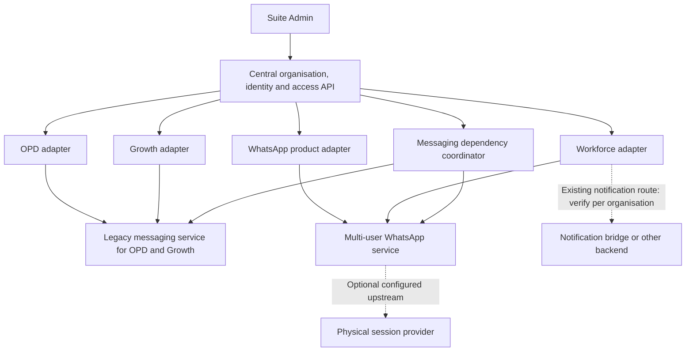

# Doctor Suite: existing WhatsApp backends and integration plan

**19 October operations update (local only):** manual payments/admin activation, grant revocation, verified messaging registry, retry worker and invitation acceptance are implemented. See [the operations handoff](SUITE_OPERATIONS_HANDOFF.md) for exact scope, unapplied migrations and later rollout. This supersedes older descriptions below of these components as proposed. Product provisioning adapters and enforcement inside the four apps remain unfinished.

Prepared 18 October 2026 from local source and local environment inspection. This is a design update, not a deployed integration. No live messages, user creation, database writes, session disconnections or credential changes were performed. Secret values are deliberately omitted.

## Decision

**19 October local implementation update:** the legacy backend source is confirmed as `D:\app folder\WHATSAPP-PERSISTENT-multi-users-master\NodeBackend`; OPD and GMB already create users there. Read-only connectors are now installed locally in all five services. Task's connection screen now uses its own authenticated Edge Function and a dedicated modern WhatsApp bridge that preserves existing users and rejects tenant reassignment. Existing notification routes, legacy provisioning and older API-key callers remain unchanged. None of these new changes is deployed; the user requested local preparation only. Details and environment templates are in the OPD repository's `suite-integrations/README.md`. The source inventory below describes the original reviewed flows; its browser-key issue is addressed in the new local Task path, while deployed callers and credential rotation remain pending. Shared messaging schema and per-product access enforcement below remain proposed.

Keep the existing messaging deployments initially. Model a **product** (what a customer buys) separately from a **messaging backend instance** (where a user/session/message actually lives).

OPD and Growth already depend on legacy messaging infrastructure. Workforce already provisions users into the WhatsApp multi-user service. Provisioning four products as four unrelated systems would duplicate users, miss these dependencies and risk sending through the wrong session.

Do not repoint all apps to the bundled WhatsApp backend as part of Suite Admin activation. First register the existing routes and identities, then make their administration consistent. Consolidating messaging servers is a separate, optional migration.

## What the repositories show

| Consumer / operation | Current local evidence | Integration consequence |
|---|---|---|
| OPD manual messages | `netlify/functions/_shared/whatsappClient.ts:3,42` defaults to `https://lionfish-app-nmodi.ondigitalocean.app`, overridable by `WHATSAPP_API_BASE_URL`. Browser defaults to Netlify functions in `src/services/whatsappApi.ts:68`. | Register the actual deployed backend; keep the existing sender/session mapping. |
| OPD user creation / lookup | `netlify/functions/sync-user-to-whatsapp-db.ts:48` directly writes backend `users`, matching `username OR auth_id`. `_shared/userLookup.ts:9` resolves OPD Auth UUID to backend user ID. | Replace ambiguous matching with verified identity links; do not recreate users or overwrite `auth_id` because an email matches. |
| OPD scheduled messages | `netlify/functions/_shared/autoSender.ts` uses the same transport; the sender comes from `clinic_settings.whatsapp_shared_session_user_id`. | Preserve the configured clinic sender; the receptionist, scheduled worker and patient recipient are different identities. |
| Growth messages | Its `netlify/functions/_shared/whatsappClient.ts:6` has the same legacy default host as OPD, also overridable. | OPD/Growth may share a backend deployment without sharing a tenant or channel automatically. |
| Growth user creation | `supabase/migrations/20260611090000_route_whatsapp_user_sync_through_edge_function.sql` installs an AFTER INSERT trigger. `sync-user-to-neon/index.ts:85,131` forwards public user ID and Auth ID to a Netlify webhook, defaulting to `https://gmbreviewsystem.com/.netlify/functions/webhook-sync-user`. The webhook calls `_shared/userLookup.ts:64`, which can insert a backend user despite old READ ONLY comments. | Include the trigger, Edge Function, Netlify webhook and backend database mapping in migration. A new central adapter must not race the existing writer. |
| Workforce QR and admin-user sync | Local `.env` sets `VITE_EXTERNAL_WA_API_URL` to `https://whatsapp-automation.limsapp.in`. `src/components/WhatsAppConnection.tsx:57` selects active organisation admins and syncs them on screen load. `src/services/externalWhatsAppService.ts:87` calls `/api/external/users/sync-admins`. | This is an existing dependency on messaging provisioning, not an independent fourth user database to populate blindly. Currently only admins are synced by this path, not all staff. |
| Multi-user backend receives Workforce users | `NodeBackend/server/externalApiRoutes.ts:97` inserts users using the supplied Task public-user ID and organisation ID. On ID conflict it updates organisation and role. Email/username collisions can create a separate external identity with an empty email. `/api/external/users/sync` only validates an existing user. | Preserve existing IDs and sessions; inventory both normal-login and externally synced identities before deciding whether they represent the same person. Reject tenant reassignment through a sync request. |
| Workforce notifications | `supabase/functions/send-whatsapp/index.ts:33,186` and `process-whatsapp-queue/index.ts:23,218` use an organisation's `whatsapp_api_endpoint`, otherwise `WHATSAPP_API_URL`, otherwise `https://lionfish-app-2-7r4qe.ondigitalocean.app/api/send-notification`. | QR host does not prove the notification destination. Inventory every effective organisation route, including any bridge behind this endpoint. |
| Multi-user backend upstream transport | `NodeBackend/server/services/WhatsAppSessionManager.ts:1784` enables a proxy when server `EXTERNAL_WA_API_URL` is set; `ExternalWhatsAppProxy.ts` forwards to that upstream. | An API host may not own the physical session. Inventory upstream transport separately; detect self-proxy/cycles. Local env inspection did not establish the deployed value. |
| Incoming HR bot actions | `NodeBackend/shared/schema.ts:256` stores Task organisation/user IDs plus `hr_admins.whatsapp_user_id`. `server/routes.ts:2139` checks the incoming session owner against that mapping. | Preserve HR bot bindings and enforce Workforce permissions on inbound task/leave actions, not just outbound messages. |

Paths in the table are relative to the relevant product repository. The inspected repositories are listed in `DOCTOR_SUITE_PLATFORM_PLAN.md`.

**Confidence boundary:** the user's described grouping and the local code agree on a legacy OPD/Growth service and a Task/multi-user WhatsApp service. Matching default URLs do not prove matching live databases, and local `.env` is not deployed configuration. The notification bridge and optional upstream proxy may add further service instances. Do not mark the inventory verified until deployed settings and tenant mappings are checked read-only.

## Intended topology

The coordinator manages mappings and desired access. Product servers continue to send operational messages through their verified route. Central admin does not need patient-message bodies or direct access to all backend databases.

## Schema additions needed before adapters

The existing `suite_bindings` model supports one tenant binding per product and the current secrets select one adapter per product. That is sufficient for the initial admin scaffold, but **not sufficient for shared messaging dependencies**. Add an additive migration and version the contract before enabling connected provisioning.

Proposed tables (not implemented yet):

| Table / entity | Fields and constraints |
|---|---|
| `suite_app_instances` | Stable instance ID, product code, environment and deployment reference. Map existing product bindings to their intended instance without changing local tenant IDs. |
| `suite_messaging_backends` | Stable backend ID, environment, adapter kind, configured endpoint reference, credential reference, optional upstream ID, verified status. Separate logical API service from physical session provider when needed. No secret values in browser-visible rows. |
| `suite_messaging_tenants` | Central organisation + backend instance -> local messaging tenant/account ID. Unique organisation/backend/environment mapping; a local tenant cannot silently map to two central organisations. Where legacy data is user-owned, record that ownership model explicitly instead of inventing a tenant column. |
| `suite_external_identity_links` | Central person + source app instance + source issuer/local user ID -> messaging backend/local user ID. Support reviewed multiple legacy accounts for one person; preserve Auth UUID, public profile ID and backend ID as distinct fields. Unique source mapping, never email-only linking. |
| `suite_messaging_channels` | Backend, local session owner, local session ID/name, owning organisation/location, provider and connection state. Preserve provider-specific IDs; do not export session credentials to the central browser. |
| `suite_messaging_routes` | Organisation + consuming app instance + purpose -> channel/backend, version, enabled state and verification state. Purposes include `opd.reminders`, `growth.review_requests`, `workforce.notifications`, `workforce.hr_bot`, `whatsapp.campaigns`. At most one active route per scope; no global default organisation. |
| `suite_messaging_grants` | Organisation, consuming product, purpose, validity, quota bucket and grant source. Dependency access is separate from a full WhatsApp product subscription. |
| Dependency jobs / receipts | Extend the existing outbox with resource key, dependency edges, target backend, lease/version and per-target receipt. Product jobs can depend on a shared messaging-tenant job; do not send the same creation twice via Workforce and WhatsApp. |

Use composite organisation/environment references to prevent routes from pointing to another clinic's channel. Configured endpoints must be server-controlled and allowlisted. Validate any upstream chain, reject cycles and verify the destination's backend identity before sending credentials.

If OPD and Growth share a physical backend, they still get separate purpose grants. If they actually use separate deployments in production, register separate backend IDs without changing the product model. Backend IDs, not hostnames alone, define the namespace for local IDs.

## Access and trial behaviour

Recommended commercial rule: transactional messaging is a capability of its parent product, with an explicit quota. Full WhatsApp campaigns/automation are a separately entitled product. Preserve existing customer entitlements during migration rather than forcing a new commercial rule retroactively.

| Customer state | Effective behaviour |
|---|---|
| Workforce active, WhatsApp campaigns not purchased | Allow included task/attendance notifications and authorised HR actions. Do not grant campaigns or full WhatsApp admin access merely because a backend user exists. |
| WhatsApp active, Workforce expired | Keep entitled WhatsApp campaigns available; deny task/leave mutations and new Workforce notifications. |
| OPD active, Growth expired | Keep entitled OPD reminders; deny new Growth review requests even if they share the same sender. |
| One member disabled in Workforce | Revoke that person's Workforce permissions. Do not globally disable the shared backend account if separately entitled WhatsApp access remains. |
| Organisation suspended | Deny protected activity for that organisation across every route, including inbound bot tools and queued work. Retain records/session metadata for recovery. |
| Bundle trial | All included products use the same exact seven-day/168-hour window. Dependency creation does not start another trial. Start when provisioning/access enforcement is acknowledged; QR connection is a separate onboarding state shown to the admin. |

Every send checks the originating product/purpose, organisation, sender route, current access and quota. Check at enqueue time and again at dispatch time; a job queued before expiry is not permission to send afterwards. For a background task, validate the authorised system sender and relevant owner/membership rules rather than assuming the recipient is the sender. A credential for Workforce cannot label a send as OPD to bypass expiry.

Never globally disconnect a shared session just because one consuming product expires. Keep routing/grants separate so another active product can keep using its authorised channel. Do not silently resend expired pending work on renewal; apply an explicit age/approval rule.

## Provisioning and identity reconciliation

1. Select central organisation, product plan and the already verified backend routes. Resolve verified existing identity links; ambiguous collisions stay pending for review.
2. Create product tenants with stable local IDs. For an existing customer, link its tenant after checking ownership rather than creating a replacement.
3. Resolve each messaging dependency once per central organisation/backend. Both the Workforce job and WhatsApp product job depend on that same resource when they share it.
4. Reuse approved backend-user mappings. For a genuinely new mapping, provision idempotently with a source namespace. Never change an existing user's organisation on an ID conflict. Never copy passwords between apps.
5. Assign product-specific roles and messaging-purpose permissions. A Task `superadmin`, WhatsApp backend `super_admin` and Suite Super Admin are different authorities. The suite administrator remains the verified configured account only.
6. Preserve session-owner IDs and HR bot records. Separately map the human staff actor, message recipient, service sender and channel owner; they are often different users.
7. Write all required routing/access mirrors, then return readiness for each dependency. A missing messaging route blocks only products for which messaging is a required included capability. Show configuration readiness and QR connection state separately.
8. Activate the shared trial only after the selected bundle's required dependencies enforce access. Retry failures with the same resource/job identifiers; do not roll back by deleting existing users or sessions.

For existing Workforce/WhatsApp duplicates, one central person may initially retain multiple backend identities. The existing external sync intentionally handles email collisions, so merging them automatically would risk losing the session-owning account. Migrate to one shared identity only after ownership, session references, foreign keys and login behaviour are reconciled.

## Changes required in existing integrations

- **Workforce browser:** replace the `VITE_EXTERNAL_WA_API_KEY` machine credential with an authenticated server-side facade. The reviewed frontend currently embeds that key and sends organisation/admin lists from the browser. The server must derive the active caller, organisation and permitted admin list itself. Coordinate rotation of exposed/default shared credentials after callers migrate.
- **Multi-user service:** add scoped integration credentials and central mapping checks. Existing `/sync-admins` trusts caller-supplied IDs/organisation and overwrites organisation on conflict; the suite path must reject conflicts and implement versioned disable/revoke as well as create/update. Do not change global roles from a product membership blindly.
- **OPD:** adapt the direct database sync and Auth-ID lookup to verified mappings. Preserve `whatsapp_shared_session_user_id`. User-facing proxy/sync handlers need verified caller/clinic scope before the new integration can acknowledge enforcement; body-only `clinicId` presence is not authorisation.
- **Growth:** route insert-trigger provisioning through the same idempotent adapter workflow. Make authentication required on every webhook hop, add retry/receipt handling, and migrate existing users explicitly. Replace reliance on stale READ ONLY comments with the actual insert behaviour. New central user creation must not race the existing trigger.
- **Workforce sends:** reconcile connection UI, direct sends, batch sends, notification queue, database webhooks and per-organisation endpoints to the route registry. The queue's `notification.user_id` is the recipient; do not treat it as the session owner without a verified mapping.
- **Inbound bots:** apply access and membership checks to HR task/leave commands and any configured OPD bot path, including service-role tools. Preserve `hr_admins.whatsapp_user_id` and any configured clinic bindings. Disabling outbound messages alone does not deactivate a product.
- **All workers:** deduplicate on `(source app instance, source event ID, purpose)` across retries/webhooks/cron. Persist route version and backend receipt. A timed-out send is ambiguous; reconcile its receipt before retrying or switching backend. Do not promise exactly-once delivery unless the receiving transport supports durable idempotency.

These are observed integration requirements, not fixes already applied to those repositories.

## Configuration ownership

| Location | Configuration |
|---|---|
| `suite-admin/.env.local` / Netlify admin build | Existing central Supabase URL and public key only; no extra messaging credentials needed. |
| Central Supabase Edge Function secrets | Product adapter credentials plus separate credentials for each verified messaging adapter. Future service settings must be added with the coordinator implementation; adding arbitrary env names now will not enable it. |
| Product server / Edge Function secrets | Scoped messaging integration credential and central access-refresh credential for that product. |
| Messaging backend server | Its own DB/session/provider secrets and scoped consumer credentials. Keep them out of admin/frontend builds. |
| Central configuration tables | Non-secret backend IDs, purpose routes, approved tenant/user/channel mappings and secret references. |

## Implementation order and acceptance

1. **Read-only deployed inventory:** compare actual OPD/Growth hosts and DB identities; Task QR, notification and organisation overrides; multi-user upstream settings; sender accounts, sessions, HR bindings, live triggers and schedules. Locate source/deployment ownership for the legacy service and notification bridge. Do not infer these from default hostnames or send test messages during inventory.
2. **Central schema/contract extension:** add backend instances, identity/channel routes, purpose grants and dependency jobs. Update Suite Admin with backend connection health, per-product messaging readiness, mapping conflicts and retry status. Extend server-only RPC/access tests.
3. **Workforce + WhatsApp shared dependency first:** implement the scoped server facade and adapter, then reconcile one test organisation with both products. Verify no duplicate backend user on retries/concurrent provisioning and no cross-product disable.
4. **Legacy OPD/Growth dependency:** implement its adapter at the actual owning backend, reconcile IDs and replace direct writes/trigger duplication per migrated tenant. Preserve all existing sessions.
5. **Controlled cutover:** shadow-read mappings first; shadow mode must never send. Stop/drain or reconcile old writers/workers for one tenant, activate one route version, and send only authorised test messages to designated test recipients. Keep old mappings/receipts for rollback. Never run two active senders for the same event.
6. **Expand after acceptance:** test standalone product, bundle, seven-day boundary, extensions, organisation suspension, member removal, reconnects, expired queues, backend outage, route mismatch, stale version and inbound bot commands. A user/tenant on the wrong backend must be rejected, not auto-created or routed through a fallback.

Release tests must cover same-email/different-ID users, simultaneous Workforce/WhatsApp provisioning, shared-channel access after one product expires, notifications going to the right recipient from the right sender, duplicate webhook/cron delivery, unknown send outcomes, and rollback without changing session ownership. Product adapter acknowledgement must include actual messaging enforcement for required dependencies.

## Current status

The standalone Suite Admin frontend and initial four-product control plane exist locally. This document corrects the messaging architecture before adapter implementation. Backend-instance tables, dependency coordination, facades, route migration and messaging enforcement remain to be implemented and tested. No production routing was changed by this review.
